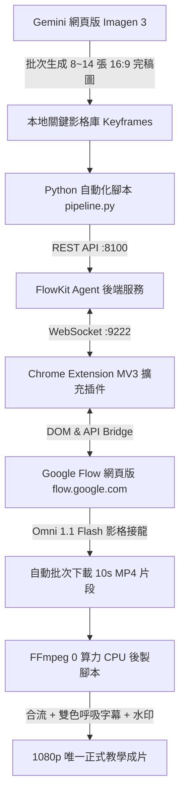

# Google Flow 全自動 AI 製片生產線 (FlowKit Pipeline)

<div align="center">

[](https://opensource.org/licenses/MIT)
[](https://www.python.org/downloads/)
[](https://developer.chrome.com/docs/extensions/mv3/)
[](https://flow.google.com)
[-purple.svg)](https://gemini.google.com)

**專為 Google Flow (`flow.google.com`) 設計的 6 鏡接龍全自動 AI 動畫生產線。**  
徹底解決傳統 AI 影片「畫面跳變破圖」、「唇形不合」、「運鏡呆板」與「批次操作費力」的四大痛點！

</div>

---

## 📌 為什麼需要這套工具？

Google Flow 是目前最強大的長影音與多模態 AI 創作平台，但手動操作存在許多門檻：
1. **手動繁瑣**：每 10 秒鏡頭都要手動上傳首尾影格、貼上提示詞、點擊生成、等候並手動下載。
2. **畫面容易跳變**：一般人隨機生圖，鏡頭銜接時角色臉形或背景每鏡都在突變。
3. **語音嘴型脫節**：若用外部配音合成，影片人物嘴型完全對不上。
4. **運鏡像監視器**：隨機寫提示詞，鏡頭動也不動，缺乏電影感推拉鏡頭（Zoom In / Zoom Out）。

**本專案提供一整套標準化開源工具鏈（Chrome Extension + Python Agent + 自動批次接龍 + 0 算力後製），實現一鍵自動化產出 60 秒至 180 秒高畫質教學動畫！**

---

## 🏗️ 核心架構圖 (Architecture)



---

## ⚠️ 必看：三大核心弱點與避坑指南 (The 3 Critical Gotchas)

### 弱點一：算力方案門檻（務必使用 Gemini Pro）
- ❌ **免費版帳號**：每日僅有 50 點贈送額度，生成 2 個 10 秒鏡頭（每鏡約 25~30 點）就會直接卡死。
- ✅ **官方解法**：必須訂閱 **Gemini Pro（Google AI Pro / Google One AI Premium，約 NT$650/月）**。
  - 每月固定贈送 **1,000 點 Google Flow 算力點數**。
  - 1,000 點足夠生成 33～40 個鏡頭，相當於每月可完整產出 3～4 部 60 秒定格動畫教學片！

### 弱點二：關鍵影格生圖額度（Gemini 網頁版 vs IDE/本地 API）
- ❌ **本地 API / IDE 插件**：生圖額度通常極小，批次生成 4~5 張便容易遭遇 `429 RESOURCE_EXHAUSTED` 報錯中斷。
- ✅ **官方解法**：分鏡關鍵圖底圖一律直接前往 **Gemini 官方網頁版 (gemini.google.com)** 使用 Imagen 3 生成。網頁版享有海量日常額度，生成後直接批次下載至 `keyframes/` 資料夾。

### 弱點三：語音模型與嘴型原生對齊（Native Character Voice）
- ❌ **外部 TTS 後製合成**：將無聲影片拿去外部剪映或 Edge-TTS 壓音，唇形與台詞完全不同步，甚至被 Flow 誤判生成英文廢話。
- ✅ **官方解法**：直接在 Google Flow 內建的 **Characters（人物模型庫）** 中建立專屬人物模型：
  1. 進入 Google Flow 左側導航 `Characters` $\to$ 點擊 `New Character`。
  2. 上傳老師臉部三視圖/完稿圖，命名為 `@teacher`。
  3. 在 `Voice Performance` 中輸入 **Voice Customization Prompt**（如：*自然親切、語調溫暖的台灣男聲，語速適中*），試聽滿意後點擊 `Save New Voice`。
  4. 提示詞結尾直接使用：`Voice prompt with @teacher speaking in Taiwanese Mandarin: "..."`。
  5. **Flow Omni 1.1 Flash 會原生以該聲音模型同時合成音訊與臉部肌肉動作，唇形 100% 精準對齊！**

---

## 🎥 運鏡秘訣：如何做出電影感 Zoom In / Zoom Out？

很多學員反饋產出的鏡頭像固定監視器，要做出好萊塢等級的動態推拉，請掌握兩大原則：

### 1. 提示詞嚴禁出現「Fixed Tripod」
- ❌ 錯誤寫法：`Fixed camera on tripod`, `Locked off camera`（這會強制模型凍結機位）。
- ✅ 推進（Zoom In）：`Cinematic slow push-in (dolly in / smooth zoom in) toward the subject`
- ✅ 拉遠（Zoom Out）：`Dramatic cinematic pull-back (dolly out / wide zoom out) revealing the environment`
- ✅ 平移（Pan / Truck）：`Smooth lateral camera tracking right across the table`

### 2. 終極秘訣：「首尾景別反差接龍」（Framing Contrast）
在 6 鏡接龍中，只要設定前後景別反差，模型會被**物理強制在 10 秒內平滑過渡**：
- **動態推鏡（Zoom In）**：
  - 起始影格（Start Frame）：**中景（Medium Shot）**
  - 結束影格（End Frame）：**極端微距特寫（Extreme Macro Close-up）**
- **動態拉鏡（Zoom Out）**：
  - 起始影格（Start Frame）：**微距特寫（Macro Close-up）**
  - 結束影格（End Frame）：**大遠景/全景（Wide Establishing Shot）**

---

## 🚀 快速上手 (Quick Start)

### 步驟 1：安裝 Chrome 擴充插件
1. 開啟 Chrome 瀏覽器，進入 `chrome://extensions/`。
2. 開啟右上角 **「開發人員模式」**。
3. 點選 **「載入未封裝項目」**，選擇本專案的 `extension/` 目錄。
4. 在瀏覽器開啟 `flow.google.com` 並登入您的 Google AI Pro 帳號。

### 步驟 2：啟動 Python 後端服務
```bash
# 安裝相依套件
pip install -r requirements.txt

# 設定當前 Flow 專案 ID（可從網址列取得：flow.google.com/project/<project_id>）
$env:FLOW_PROJECT_ID="your-project-uuid-here"

# 啟動 Agent 後端
python -m agent.main
```
終端機顯示 `Agent listening on 127.0.0.1:8100` 與 `WebSocket bridge on :9222` 即代表連線就緒。

### 步驟 3：執行批次接龍生成
```bash
python scripts/pipeline.py --script templates/storyboard_template.json
```
程式將自動：
1. 依序上傳 `keyframes/` 內的所有關鍵影格至 Google Flow 圖庫。
2. 自動派發 6 大鏡生成任務，指定首尾影格與 @teacher 語音提示詞。
3. 自動下載完成的 6 個 1080p MP4 影片片段。

### 步驟 4：一鍵 0 算力 CPU FFmpeg 後製
```bash
# 自動生成微軟正黑體雙色呼吸教學字幕
python scripts/make_subtitles.py templates/storyboard_template.json output/subtitles.ass

# 一鍵拼接片頭 + 6 鏡影片 + 燒錄字幕 + 水印
python scripts/assemble_video.py output/clips cover.jpg output/subtitles.ass output/master_1080p.mp4 badge.png
```

---

## 📂 專案目錄結構

```
google-flow-pipeline/
├── agent/                  # FastAPI 後端與 WebSocket 控制中心
│   ├── main.py             # 服務主入口 (埠號 8100 / 9222)
│   ├── config.py           # 系統組態
│   └── services/           # 任務排程與 Flow API 封裝
├── extension/              # Chrome MV3 擴充插件原始碼
│   ├── manifest.json       # 擴充功能清單
│   ├── background.js       # 背景通訊服務
│   └── content.js          # Google Flow 頁面注入腳本
├── scripts/                # 自動化執行腳本
│   ├── pipeline.py         # 批次接龍生成客戶端
│   ├── make_subtitles.py   # 雙色教學字幕產生器
│   └── assemble_video.py   # FFmpeg 一鍵後製合成器
├── templates/              # 分鏡與角色範本
│   ├── storyboard_template.json  # 標準分鏡劇本格式
│   └── character_profile.json    # @teacher 語音與外觀定義
└── README.md               # 專案完整說明手冊
```

---

## 📜 開源許可證

本專案採用 [MIT License](LICENSE) 開源授權，歡迎自由修改、擴充與商業應用！
如對工作流有任何疑問或改進建議，歡迎提交 Issue 或 Pull Request。
